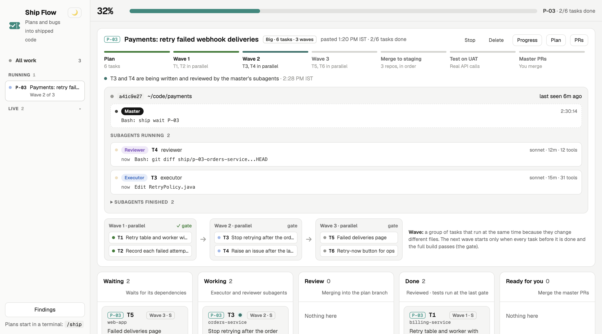

# ship-flow

Plan a change with Claude Code, then type `/ship`. The same session runs the whole plan with **subagents**: a Sonnet executor writes each task, a Sonnet reviewer checks it round after round, a fresh Opus reviewer signs it off, and a tester checks it on staging. Your planning session is the **master**: it already knows the plan, so when something gets stuck it fixes it. No new sessions, no watchdog.

A web page shows the master and every subagent live, with each plan's waves, tasks, findings and PRs.



## Install (one line)

```bash
curl -fsSL https://raw.githubusercontent.com/prathambhatia/ship-flow/main/install.sh | bash
```

It needs [Claude Code](https://claude.com/claude-code), [Bun](https://bun.sh), git and jq. It clones ship-flow to `~/.ship-flow`, puts the `ship` command in `~/.local/bin`, and installs the Claude Code plugin. Run it again to update.

## Try the page

```bash
ship demo
```

This opens the dashboard with made-up plans, so you can look around before you set anything up. Light mode is the default; the moon button switches to dark.

## Use it

`/ship` is the only command you need. After that, you just talk to the session.

1. Plan a change with Claude Code in your project, as you normally would.
2. Type `/ship`. Claude turns the plan into tasks, shows you the list and asks to start.
3. Say yes. That session is now the **master**: its subagents appear at the bottom of your terminal, and it opens the dashboard in your browser.
4. Ask it anything in plain words: "why is T3 stuck?", "how far along is it?", "take over P-07".
5. When the master PRs are ready, merge them from the page.

## Changing the plan

Tell the master session in plain words, for example "T4 should also handle refunds" or "drop the retry button". It works out which tasks change, updates only those, and passes the change to the subagents working on them. Every other task keeps going. You never write a patch or run a command for this.

## You need a backend

ship-flow does the Claude part: planning, writing, reviewing, testing. The fixed steps (worktrees, merges, builds, staging deploys, PRs) belong to your project, so they live in a **backend**: a small local HTTP service. `BACKEND.md` lists the calls it answers. Point ship-flow at it in `~/.claude/ship/config.json`:

```json
{
  "backends": { "myproject": { "url": "http://127.0.0.1:4323" } },
  "projects": { "/Users/you/code/myproject": "myproject" }
}
```

With one backend, every project uses it.

## What is inside

| Path | What |
|---|---|
| `skills/ship/` | The `/ship` skill: the master's loop, and the plan format |
| `agents/` | executor, reviewer, signoff, security, debugger, tester |
| `bin/ship` | The CLI the master and subagents use; `ship help` lists every command |
| `hooks/` | Send each tool call and subagent start or stop to the page |
| `ui/` | The dashboard (plain HTML, CSS and JS, no build) |
| `install.sh` | The one-line installer |

## Safety

Subagents never push or merge. Only the backend does, and merging to production waits for your click on the page.
